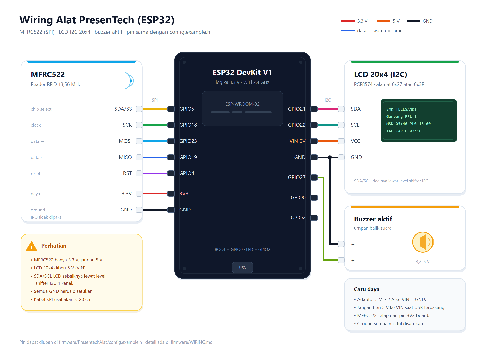

# Wiring Alat PresenTech — ESP32 + MFRC522 + LCD 20x4

Panduan merakit perangkat pembaca kartu RFID PresenTech. Pin di bawah **sama dengan**
nilai bawaan `firmware/PresentechAlat/config.example.h`. Kalau kamu mengubah pin di
`config.h`, ubah juga tabel ini agar dokumentasi dan alat tetap cocok.

---

## 1. Daftar komponen

| No | Komponen | Jumlah | Catatan |
|---|---|---|---|
| 1 | ESP32 DevKit V1 (30/38 pin, WROOM-32) | 1 | Board dengan regulator 3.3V onboard. |
| 2 | Modul MFRC522 13.56 MHz | 1 | Sudah termasuk header; **wajib 3.3V**. |
| 3 | Kartu RFID Mifare Classic 13.56 MHz | 1+ | Untuk uji tap dan siswa. |
| 4 | LCD karakter 20x4 + modul I2C PCF8574 | 1 | Alamat umum `0x27` atau `0x3F`. |
| 5 | Buzzer aktif 3.3–5V (modul) | 1 | Umpan balik berhasil/gagal. |
| 6 | Breadboard / PCB + kabel jumper | secukupnya | Kabel SPI usahakan < 20 cm. |
| 7 | Adaptor 5V ≥ 2A + jack | 1 | LCD backlight + ESP32 butuh arus cukup. |
| 8 | Level shifter I2C 4 kanal (opsional, disarankan) | 1 | Melindungi GPIO21/22 saat LCD diberi 5V. |
| 9 | Transistor NPN 2N2222 + resistor 1kΩ (opsional) | 1 | Bila memakai buzzer pasif/5V besar. |

---

## 2. Diagram sambungan

```html
<p align="center">
  <a href="wiring/presentech-wiring.svg">
    
  </a>
</p>
```

Warna kabel pada gambar **hanya saran** agar mudah ditelusuri; yang wajib cocok adalah
**label GPIO** dan **tegangannya** (MFRC522 3,3 V, LCD 5 V). Titik hitam menandakan
sambungan GND yang menyatu. Klik gambar untuk membuka versi SVG (bisa di-zoom tanpa pecah).

### Tampak pin ESP32 (board 30 pin)

```
                 USB
        ┌───────────────────┐
   3V3  ┤ 1               30 ├  VIN (5V)
   GND  ┤ 2               29 ├  GND
  G15   ┤ 3               28 ├  G13
  G2    ┤ 4               27 ├  G12   ← jangan dipakai
  G4    ┤ 5               26 ├  G14
  G16   ┤ 6               25 ├  G27   → buzzer
  G17   ┤ 7               24 ├  G26
  G5    ┤ 8               23 ├  G25
  G18   ┤ 9               22 ├  G33
  G19   ┤ 10              21 ├  G32
  G21   ┤ 11              20 ├  G35
  G3    ┤ 12              19 ├  G34
  G1    ┤ 13              18 ├  G39
  G22   ┤ 14              17 ├  G36
  G23   ┤ 15              16 ├  G0    → tombol BOOT
        └───────────────────┘
```

Nomor pin fisik bisa berbeda antar board; **selalu ikuti label silkscreen**, bukan
nomor urut di gambar.

---

## 3. Tabel pin lengkap

### MFRC522 (SPI)

| Pin modul | Pin ESP32 | Warna saran | Keterangan |
|---|---|---|---|
| SDA / SS | **GPIO5** | kuning | Chip select, aktif LOW. |
| SCK | **GPIO18** | hijau | SPI clock. |
| MOSI | **GPIO23** | biru muda | Data ESP32 → modul. |
| MISO | **GPIO19** | biru | Data modul → ESP32. |
| IRQ | — | — | Tidak dipakai firmware. |
| GND | **GND** | hitam | Ground bersama. |
| RST | **GPIO4** | ungu | Reset modul. |
| 3.3V | **3V3** | merah | **Jangan 5V** — modul rusak. |

### LCD 20x4 I2C

| Pin modul | Pin ESP32 | Warna saran | Keterangan |
|---|---|---|---|
| GND | **GND** | hitam | Ground bersama. |
| VCC | **VIN / 5V** | oranye | Backlight butuh 5V. |
| SDA | **GPIO21** | merah muda | I2C data (butuh level shifter bila VCC 5V). |
| SCL | **GPIO22** | hijau toska | I2C clock (idem). |

### Buzzer & tombol

| Komponen | Pin ESP32 | Warna saran | Keterangan |
|---|---|---|---|
| Buzzer aktif `+` | **GPIO27** | hijau zaitun | `BUZZER_ACTIVE 1` di `config.h`. |
| Buzzer aktif `−` | GND | hitam | Buzzer pasif: pakai `tone()`, set `BUZZER_ACTIVE 0`. |
| Tombol BOOT | **GPIO0 → GND** | Sudah ada di board; `INPUT_PULLUP` internal. |
| LED status | **GPIO2** | LED bawaan board (aktif HIGH). |

Bila memakai buzzer 5V berarus > 20 mA, jangan dihubungkan langsung:

```
GPIO27 ──[ 1kΩ ]── B (2N2222)
                    C ── buzzer (−)
                    E ── GND
buzzer (+) ── 5V
```

---

## 4. Daya dan keamanan (penting)

1. **MFRC522 hanya 3.3V.** Memberi 5V dapat langsung merusak chip.
2. **LCD 20x4 umumnya butuh 5V.** Modul I2C PCF8574 sering memiliki pull-up
   SDA/SCL ke VCC. Bila VCC = 5V, pin GPIO21/22 akan menerima 5V saat idle —
   ESP32 tidak 5V-tolerant. Pilihan:
   - **Disarankan:** pasang level shifter I2C 4 kanal (HV = 5V, LV = 3.3V,
     GND bersama) untuk SDA & SCL.
   - **Praktik cepat di lab:** sambung langsung, banyak modul tetap bekerja, tetapi
     ini di luar spesifikasi dan berisiko jangka panjang. Kalau memilih cara ini,
     jangan tinggalkan alat menyala berhari-hari tanpa pengawasan.
   - Alternatif: coba beri VCC LCD 3.3V. Sebagian modul tetap tampil (backlight
     lebih redup, kontras perlu diputar).
3. **Ground harus bersama** untuk ESP32, MFRC522, LCD, dan catu daya.
4. **Arus:** ESP32 bisa menarik ±500 mA saat WiFi transmit. Pakai adaptor 5V ≥ 2A;
   jangan memberi daya MFRC522 dari pin 3V3 board bila board juga menyalakan LCD
   lewat USB — gejalanya kartu kadang tidak terbaca.
5. **Pin yang dihindari:** GPIO6–11 (flash internal), GPIO12 (strapping, bisa gagal
   boot), GPIO34–39 (input saja), GPIO1/3 (Serial monitor).
6. **Kabel SPI pendek.** Di atas ±30 cm, MFRC522 sering gagal inisialisasi.
7. **Antena RFID** jangan menempel logam. Jarak baca normal 1–3 cm; arahkan kumparan
   sejajar kartu.

---

## 5. Langkah perakitan

1. **Cek alamat LCD.** Sambungkan LCD (GND, VCC, SDA, SCL) lalu jalankan sketch
   I2C scanner berikut. Catat alamat yang muncul (`0x27` atau `0x3F`), lalu samakan
   `LCD_I2C_ADDR` di `config.h`.

   ```cpp
   #include <Wire.h>

   void setup() {
     Wire.begin(21, 22);
     Serial.begin(115200);
     for (byte address = 1; address < 127; address++) {
       Wire.beginTransmission(address);
       if (Wire.endTransmission() == 0) {
         Serial.printf("I2C ditemukan: 0x%02X\n", address);
       }
     }
   }

   void loop() {}
   ```

2. **Pasang MFRC522** sesuai tabel pin. Periksa ulang 3.3V dan GND sebelum menyalakan.
3. **Pasang buzzer** ke GPIO27 (dan transistor bila perlu).
4. **Pasang tombol** bila board belum punya tombol BOOT; sambungkan GPIO0 ke GND
   lewat tombol.
5. **Nyalakan alat** dengan adaptor 5V. LCD harus menampilkan `PRESENTECH` lalu
   `MENYAMBUNG WIFI` / `SETUP WIFI`.
6. **Upload firmware** (`firmware/PresentechAlat`) sesuai panduan di
   [`firmware/README.md`](README.md).
7. **Daftarkan alat** di dashboard Admin → Perangkat IoT → Tambah. Salin device key
   `ptd_...` ke `config.h`, lalu upload ulang.
8. **Tempel kartu** yang sudah didaftarkan di menu Kartu RFID. LCD harus menampilkan
   nama siswa dan status.

---

## 6. Uji cepat setelah dirakit

| Uji | Cara | Hasil yang benar |
|---|---|---|
| LCD hidup | Nyalakan alat | Baris `PRESENTECH` muncul, backlight menyala. |
| RFID terdeteksi | Serial Monitor 115200, tempel kartu | Muncul `Tap kartu: XXXXXXXXXX`. |
| Buzzer | Kirim `beep` di Serial Monitor | Berbunyi 2 kali. |
| WiFi | Serial Monitor | `WiFi : <SSID> \| TERHUBUNG` dan ada IP alat. |
| Server | Kirim `status` | `Server : http://.../api [OK]`. |
| Heartbeat | Dashboard → Perangkat IoT | Status alat berubah **Online**. |
| Absensi | Tempel kartu terdaftar | LCD `ABSENSI BERHASIL` + nama + status. |

---

## 7. Bila ada masalah

| Gejala | Penyebab umum | Solusi |
|---|---|---|
| LCD menyala tapi kosong | Alamat I2C salah / kontras | Jalankan I2C scanner, putar potensiometer kontras. |
| LCD tampil blok hitam | Kontras terlalu tinggi | Putar potensiometer ke arah sebaliknya. |
| Kartu tidak terbaca | MFRC522 dapat 5V, kabel SPI panjang, atau daya kurang | Cek 3.3V, pendekkan kabel, pakai adaptor 2A. |
| Alat restart saat WiFi connect | Catu daya lemah | Ganti adaptor; tambah kapasitor 470 µF di 5V–GND. |
| Buzzer tidak bunyi | Buzzer pasif dianggap aktif | Set `BUZZER_ACTIVE 0` atau ganti buzzer aktif. |
| Status tetap Offline | IP server salah / beda jaringan | Cek `{API}/health` dari HP, perbaiki `API_BASE_URL`. |
| Device key salah (401) | Key ter-rotate / ada spasi | Salin ulang key atau `key ptd_...` lewat Serial. |

Wiring ini sudah dipakai firmware di repo ini; kalau pin diubah, ubah `config.h`
dan tabel di dokumen ini sekaligus.

---

## 8. Mengubah diagram

Sumber gambar ada di [`wiring/presentech-wiring.svg`](wiring/presentech-wiring.svg).
Setelah mengedit SVG, render ulang PNG-nya agar preview di GitHub ikut berubah:

```powershell
# dari folder firmware/wiring
& "C:\Program Files\Google\Chrome\Application\chrome.exe" `
  --headless=new --disable-gpu --hide-scrollbars `
  --force-device-scale-factor=2 --window-size=1200,880 `
  --screenshot=presentech-wiring.png presentech-wiring.svg
```

PNG dibuat 2x (2400×1760) supaya tetap tajam di layar Retina/HP.
